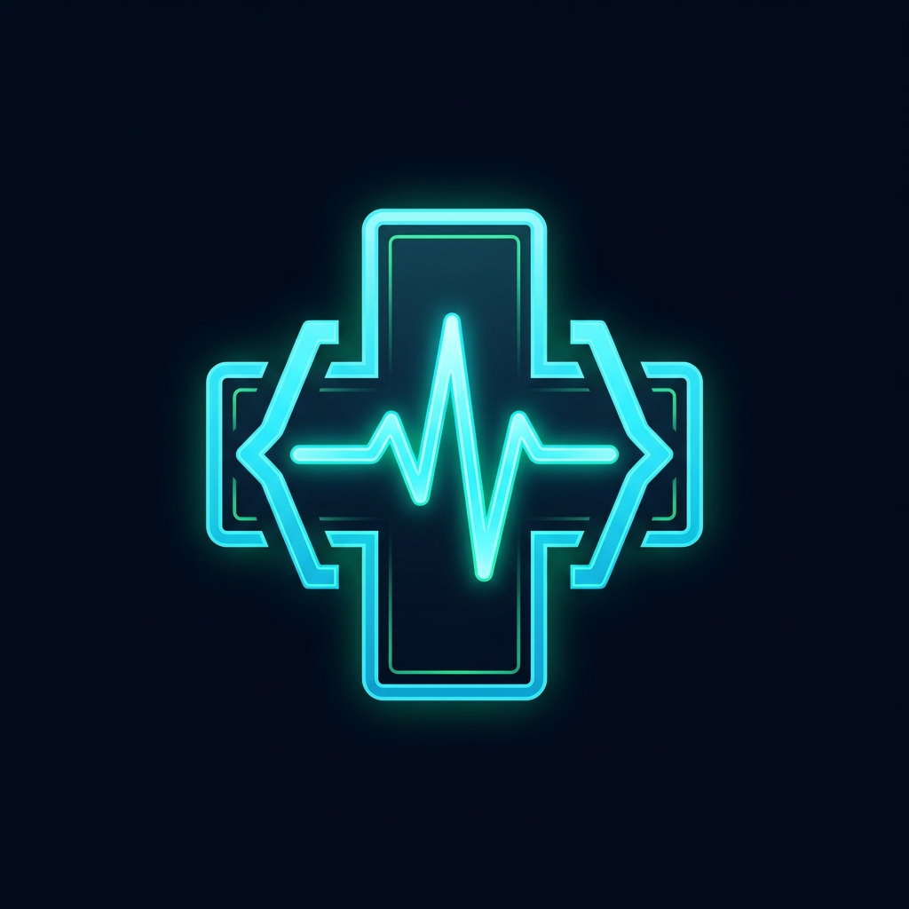
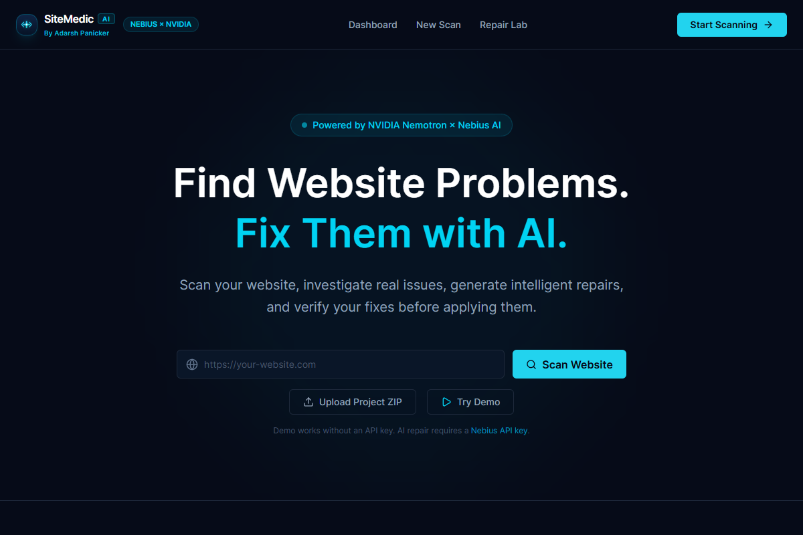
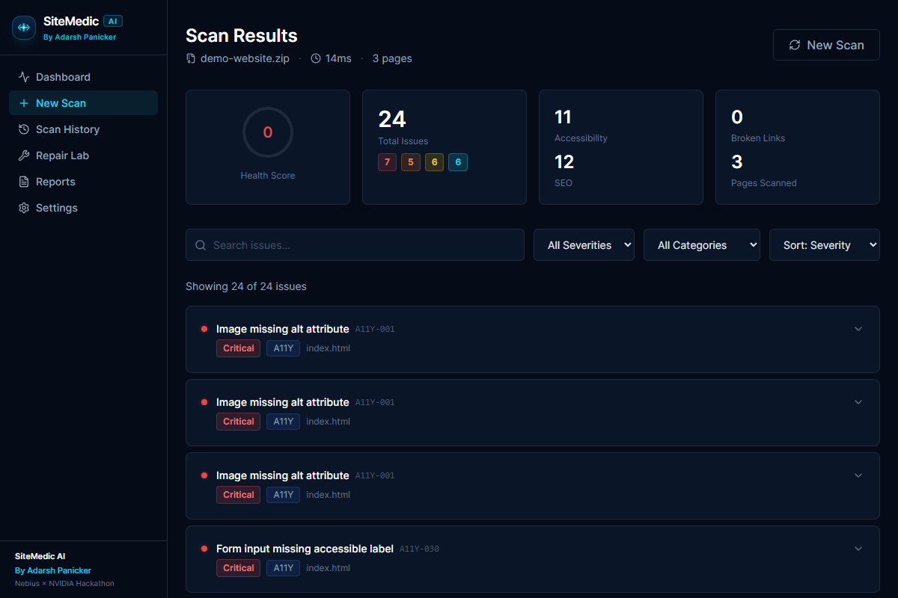
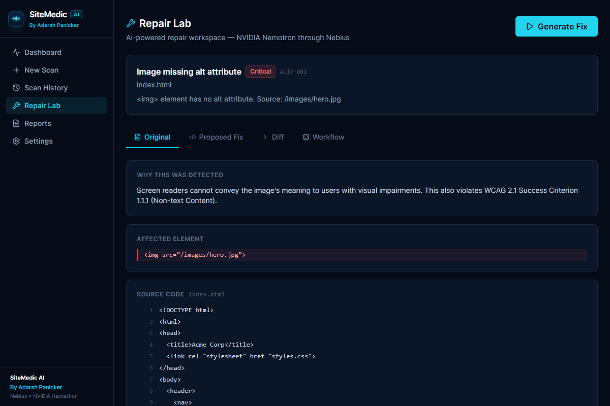
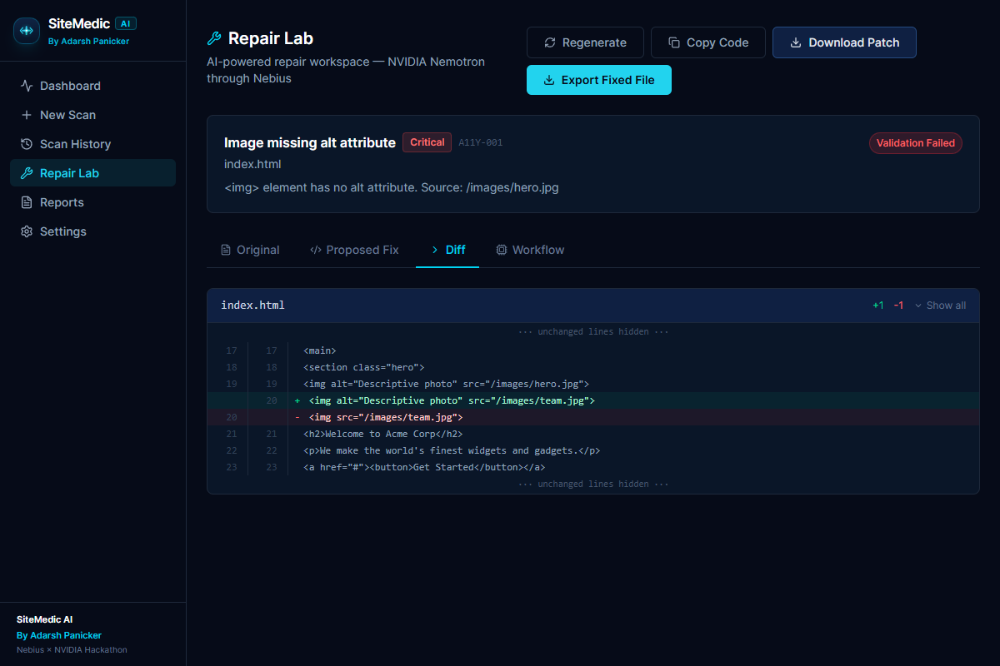
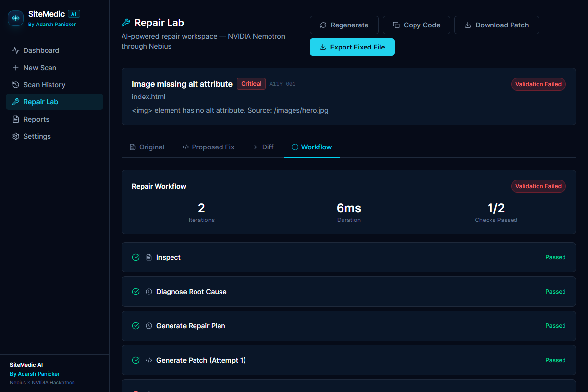
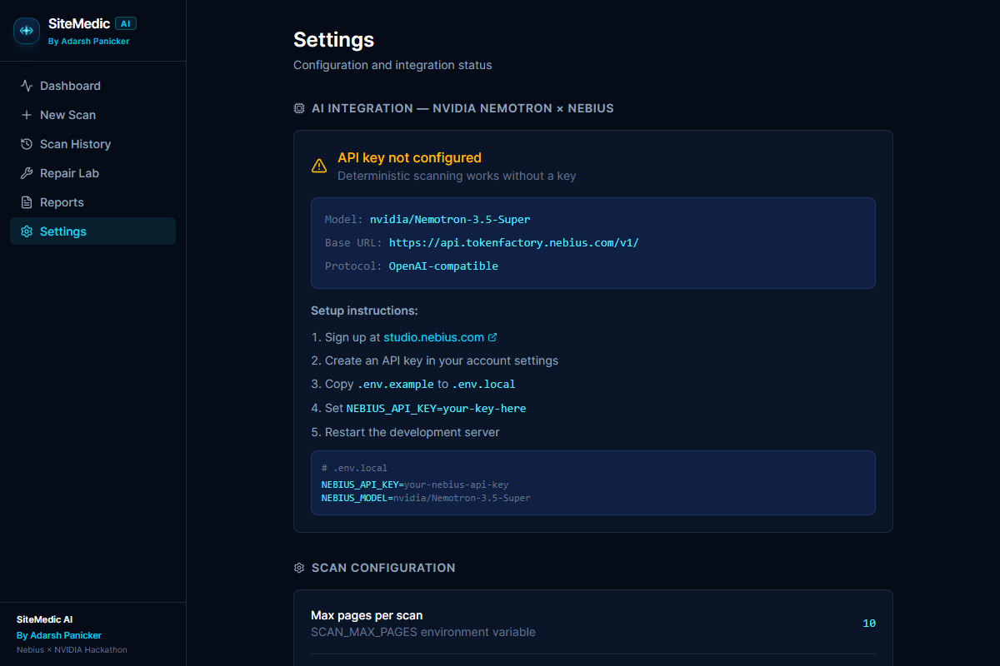
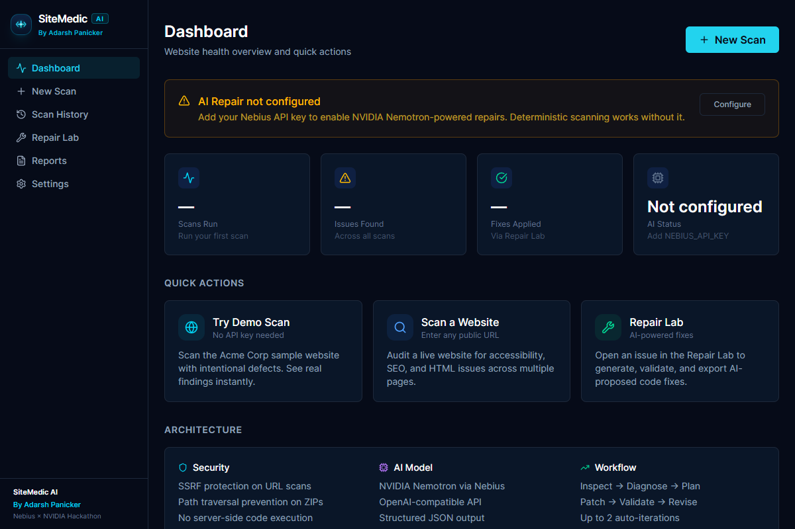

<p align="center">
  
</p>

<h1 align="center">SiteMedic AI</h1>

<p align="center">
  <strong>Autonomous Website Audit & Repair Agent</strong><br />
  <em>Diagnose root causes, generate surgical code patches with NVIDIA Nemotron, and validate fixes in an automated loop before deployment.</em>
</p>

<p align="center">
  <strong>Built by Adarsh Panicker for the Nebius × NVIDIA Global AI Hackathon (Best Apps & Agents Track)</strong><br />
  Powered by <strong>NVIDIA Nemotron-3.5-Super</strong> via <strong>Nebius Token Factory</strong> (<code>https://api.tokenfactory.nebius.com/v1/</code>)
</p>

<p align="center">
  <a href="#-key-features">Key Features</a> •
  <a href="#-screenshots--product-walkthrough">Screenshots</a> •
  <a href="#-hackathon-track--requirements-checklist">Hackathon Checklist</a> •
  <a href="#-architecture--agentic-workflow">Architecture</a> •
  <a href="#-quickstart--setup">Quickstart</a> •
  <a href="#-reproducible-sample-website-demo">Demo Site</a> •
  <a href="#-security-protections">Security</a>
</p>

---

## 💡 What is SiteMedic AI?

Traditional website analyzers (Lighthouse, axe-core, WAVE) only output long lists of warnings and leave the hard part—debugging CSS, rewriting HTML, checking contrast ratios, and verifying fixes—to developers.

**SiteMedic AI is an intelligent website doctor and autonomous repair agent.** Rather than merely listing defects or functioning as an untrusted chatbot wrapper, SiteMedic AI:
1. **Deterministic Auditing:** Scans live URLs or uploaded ZIP archives with an evidence-backed deterministic engine (Accessibility, SEO, Broken Links, HTML structure, CSS contrast).
2. **Root-Cause Diagnosis:** Analyzes defective DOM subtrees and surrounding context using **NVIDIA Nemotron-3.5-Super** via Nebius Token Factory.
3. **Surgical, Non-Destructive Code Patches:** Generates targeted code fixes without altering unaffected markup.
4. **Automated Bounded Verification:** Validates every patch using structural HTML checks and re-runs scanner rules with up to two automated revisions if validation fails.
5. **Interactive AI Repair Lab:** Provides unified colorized diffs, risk warnings, step-by-step agent workflow progress, and one-click patch (`.diff`) or corrected file downloads.

---

## 📸 Screenshots & Product Walkthrough

### 1. Modern Diagnostic Landing Page
Quick URL auditing, zero-config sample site demo, and secure ZIP project upload.


---

### 2. Deterministic Audit Results & Mathematical Health Score
Instant issue breakdown categorized by severity (Critical, High, Medium, Low), rule code (WCAG 2.1 A11y, SEO, HTML, Link integrity), and concrete code evidence.


---

### 3. AI Repair Lab Workspace
Real-time inspection of selected defects with NVIDIA Nemotron root cause diagnosis, confidence rating, and verification plan.


---

### 4. Side-by-Side Unified Diff Viewer & Patch Export
Colorized additions and deletions, risk assessment warnings, and instant download buttons for `.diff` patches or updated source files.


---

### 5. 7-Stage Agentic Workflow Progress
Transparent agent execution showing each phase: Inspect → Diagnose → Plan → Patch → Validate → Revise → Report.


---

### 6. Nebius Token Factory & NVIDIA Model Settings
Seamless API key configuration with live connectivity verification and model selection (`nvidia/Nemotron-3.5-Super` / `nvidia/Nemotron-3-Lightning`).


---

### 7. Operational Health Dashboard
Track historical scans, health score trends, resolution rates, and recently diagnosed defects.


---

## 🌟 Hackathon Track & Requirements Checklist

| Requirement | Implementation Detail | Status |
| :--- | :--- | :---: |
| **Track** | Best Apps and Agents Track | ✅ |
| **AI Cloud Platform** | Nebius Token Factory (`https://api.tokenfactory.nebius.com/v1/`) | ✅ |
| **AI Model** | `nvidia/Nemotron-3.5-Super` (with `nvidia/Nemotron-3-Lightning` fallback) | ✅ |
| **Authentication** | HTTP Bearer Token (`NEBIUS_API_KEY`) server-side via Next.js API routes | ✅ |
| **Zero-Config Demo Mode** | Sample "Acme Corp" site with actual defective files runs out-of-the-box without keys | ✅ |
| **Security Protections** | SSRF prevention (private IPs, link-local, cloud metadata blocked), ZIP path traversal protection | ✅ |
| **Agentic Workflow** | 7-stage loop: Inspect → Diagnose → Plan → Patch → Validate → Revise → Report | ✅ |
| **Automated Verification** | 28 automated tests covering scoring, scanner rules, SSRF, ZIP security, and diffs | ✅ |

---

## 🏗️ Architecture & Agentic Workflow

```
┌────────────────────────────────────────────────────────┐
│                   SiteMedic AI UI                      │
│   (Dashboard · New Scan · Repair Lab · Reports)        │
└──────────────────────────┬─────────────────────────────┘
                           │
             ┌─────────────┴─────────────┐
             ▼                           ▼
    Live Website (SSRF safe)    ZIP Archive (Traversal safe)
             │                           │
             └─────────────┬─────────────┘
                           ▼
          Deterministic Scanner Engine (Cheerio)
          - WCAG 2.1 A11Y Rules (Alt text, inputs, lang, links)
          - SEO Engine (Titles, descriptions, headings, OG)
          - Link integrity & asset existence
          - Mathematical health score algorithm [0 - 100]
                           │
                           ▼
          Bounded AI Repair Agent Workflow
  ┌──────────────────────────────────────────────────┐
  │ 1. Inspect  : Extract evidence & context snippets│
  │ 2. Diagnose : Explain root cause & impact        │
  │ 3. Plan     : Minimal surgical patch strategy    │
  │ 4. Patch    : NVIDIA Nemotron via Nebius API     │
  │ 5. Validate : Structural HTML check & rule rerun │
  │ 6. Revise   : Re-prompt if validation fails      │
  │ 7. Report   : Diff generation & patch export     │
  └──────────────────────────────────────────────────┘
```

---

## 🚀 Quickstart & Setup

### Prerequisites
- Node.js 18+ (tested on Node v20/v24)
- npm or yarn

### 1. Clone & Install
```bash
git clone https://github.com/adarsh-panicker/SiteMedic-AI.git
cd SiteMedic-AI
npm install
```

### 2. Configure Environment (Optional for Demo Mode)
The application works immediately in **Demo Mode** without any API keys.  
To enable live AI repairs with **NVIDIA Nemotron**:

```bash
cp .env.example .env.local
```

Edit `.env.local`:
```env
NEBIUS_API_KEY=your_actual_nebius_token_here
NEBIUS_BASE_URL=https://api.tokenfactory.nebius.com/v1/
NEBIUS_MODEL=nvidia/Nemotron-3.5-Super
```

### 3. Run Development Server
```bash
npm run dev
```
Open [http://localhost:3000](http://localhost:3000) in your browser.

### 4. Run Automated Test Suite
```bash
npm test
```
All 28 tests will execute, validating URL security, scanner rules, scoring, ZIP extraction, and diff computation.

### 5. Production Build
```bash
npm run build
npm start
```

---

## 🧪 Reproducible Sample Website (`demo/`)

The repository includes a documented sample website in `demo/`:
- `demo/sample-site/`: Contains real HTML and CSS files with intentional defects:
  - `A11Y-001`: Images missing `alt` attributes in `index.html`
  - `SEO-010`: Missing `<meta name="description">`
  - `A11Y-010`: Missing `lang` attribute on `<html>`
  - `LINK-001`: Broken internal reference to `mission-statement.html`
  - `CSS-001`: White text on white background in `styles.css`
- `demo/clean-reference/`: Fully compliant benchmark version for comparison.
- `public/sample-site.zip`: Downloadable ZIP archive to test the upload scan pipeline.

Click **"Try Demo"** on the landing page or `/scan` to immediately trigger a zero-config scan on this sample website.

---

## 🛡️ Security Protections

- **Server-Side Request Forgery (SSRF) Prevention:** Blocks all private/reserved IPv4 & IPv6 ranges (`10.0.0.0/8`, `172.16.0.0/12`, `192.168.0.0/16`, `127.0.0.0/8`, `169.254.0.0/16`), cloud metadata services (`169.254.169.254`), and restricted ports (SSH, database, mail).
- **ZIP Bomb & Path Traversal Prevention:** Enforces 50MB archive limits, 200MB decompressed limits, 500 file limits, and rejects relative paths (`../`, `\`, `/`).
- **Zero Host Execution:** Uploaded files and scraped websites are analyzed strictly as passive text data in memory; no user scripts are ever executed on the host server.
- **Credential Protection:** `NEBIUS_API_KEY` is exclusively consumed in server-side API routes (`/api/repair`) and never leaked to the client bundle.

---

## 👨‍💻 Author & Acknowledgements

- **Created by:** [Adarsh Panicker](https://github.com/adarsh-panicker)
- **Hackathon:** Built for the [Nebius × NVIDIA Global AI Hackathon](https://lablab.ai/event/nebius-nvidia-hackathon) (Best Apps & Agents Track)
- **Model:** [NVIDIA Nemotron-3.5-Super](https://build.nvidia.com) via [Nebius Token Factory](https://tokenfactory.nebius.com)

---

## 📄 License

Distributed under the [MIT License](LICENSE).
